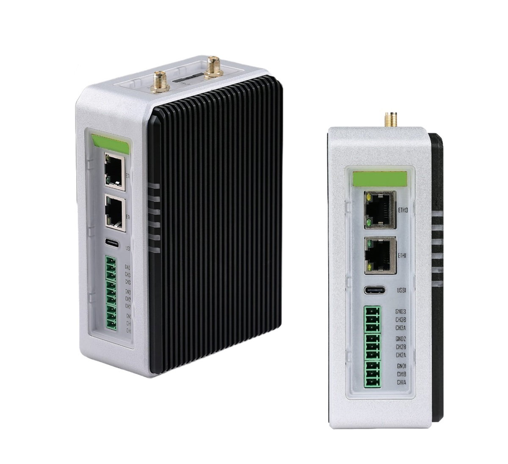

# Chromasurf — reComputer R100x CM4



<sub>Image: © [Seeed Studio](https://wiki.seeedstudio.com/recomputer_r1000_intro/)</sub>

**Chromasurf** is an industrial IoT platform built on [Elixir](https://elixir-lang.org) and [Nerves](https://nerves-project.org), developed by [Formrausch](https://formrausch.com). It provides the firmware foundation for connected HMI terminals, gateways, and sensor nodes — with automatic network clustering, over-the-air updates, real-time messaging, and full hardware abstraction built in. Designed for production use in manufacturing, process control, and industrial automation.

This repository contains the Nerves base system image for the [Seeed Studio reComputer R1000](https://wiki.seeedstudio.com/recomputer_r/) (CM4, aarch64). It includes the Linux kernel, bootloader, RS485/UART drivers, GPIO expander, and all hardware support needed to run Chromasurf applications on this headless industrial gateway. Built on `nerves_system_br` (Buildroot).

## Using

Add the system as a dependency in your Nerves app and set `MIX_TARGET=recomputer_r100x_cm4`:

```elixir
# mix.exs
{:recomputer_r100x_cm4, github: "chromasurf/recomputer_r100x_cm4", runtime: false, targets: :recomputer_r100x_cm4}
```

```bash
export MIX_TARGET=recomputer_r100x_cm4
mix deps.get
mix firmware
mix burn
```

The system ships Erlang/OTP 29 — your application needs Elixir ≥ 1.20. When using NervesKey/ATECC608A, depend on `nerves_key_pkcs11 ~> 1.3`.

## Hardware Revisions

This system defaults to **V1.1** hardware. For a V1.0 board, copy the system's `config.txt` into your app, change
the overlay line and point `CHROMASURF_CONFIG_TXT` at the copy (see [Boot Files](#boot-files)):

```
dtoverlay=reComputer-R100x,uart2
```

Key differences:

| | V1.0 (`uart2`) | V1.1 (default) |
|---|---|---|
| PCA9535 I2C | I2C3 | I2C5 |
| LoRa SPI | `/dev/spidev0.0` | `/dev/spidev1.1` |
| LoRa I2C | `/dev/i2c-1` | `/dev/i2c-6` |
| Buzzer | GPIO21 (direct) | PCA9535 P15 (sysfs) |

See [Seeed V1.1 change details](https://wiki.seeedstudio.com/recomputer_r1000_v1_1_description/) for full list.

## Boot Files

The system's `fwup.conf` writes `config.txt`, `app.txt` and the two kernel command lines. `config.txt` ends
with `include app.txt`, and the system's `app.txt` holds only a comment. To add or override
`config.txt` lines, set `CHROMASURF_CONFIG_APP` to your own `app.txt`, as in the example below.

In the Nerves systems (`nerves_system_rpi4` and others) you copy the system's `fwup.conf` and point
`config :nerves, :firmware, fwup_conf:` at the copy. Here the system's `fwup.conf` stays in use and you set
the variables below; `app.txt` exists only in these systems.

```elixir
# config/target.exs of the app; __DIR__ is the app's config/ directory
System.put_env("CHROMASURF_CONFIG_APP", Path.expand("app.txt", __DIR__))
```

```
# config/app.txt
dtparam=ant1=on
```

The firmware reads `gpu_mem` before it follows `include`; for another `gpu_mem`, replace the
whole `config.txt`. The other variables replace a file:

```elixir
# config/target.exs of the app: config/config.txt, config/cmdline-a.txt, config/cmdline-b.txt
System.put_env("CHROMASURF_CONFIG_TXT", Path.expand("config.txt", __DIR__))
System.put_env("CHROMASURF_CMDLINE_A", Path.expand("cmdline-a.txt", __DIR__))
System.put_env("CHROMASURF_CMDLINE_B", Path.expand("cmdline-b.txt", __DIR__))
```

| Variable | Replaces | Written to |
|---|---|---|
| `CHROMASURF_CONFIG_APP` | `app.txt` | both boot partitions |
| `CHROMASURF_CONFIG_TXT` | `config.txt` | both boot partitions |
| `CHROMASURF_CMDLINE_A` | `cmdline-a.txt` | `cmdline.txt` of slot A |
| `CHROMASURF_CMDLINE_B` | `cmdline-b.txt` | `cmdline.txt` of slot B |

Start from the system's files in `~/.nerves/artifacts/recomputer_r100x_cm4-portable-<version>/images/` and keep their
`root=` partitions. Building the firmware needs fwup 1.12 or later.

## Reboot on Kernel Errors

The command line carries `oops=panic` and `sysctl.kernel.panic_on_rcu_stall=1`: an oops or an RCU stall
panics the kernel, and the watchdog restarts the board (about 30 s). `loglevel=5` passes KERN_NOTICE
messages to the consoles, the pstore console included. To switch the reboot off at runtime:

```elixir
File.write!("/proc/sys/kernel/panic_on_oops", "0")
File.write!("/proc/sys/kernel/panic_on_rcu_stall", "0")
```

or at build time with `CHROMASURF_CMDLINE_A` / `CHROMASURF_CMDLINE_B` pointing at command lines without
both parameters.

## Nerves 2 and EROFS

The system builds under Nerves 1.15 and Nerves 2. It ships `images/rootfs.tar`, the kernel has
`CONFIG_EROFS_FS` and `CONFIG_SQUASHFS_ZSTD`, and the command line names no root filesystem type.

To move an app to Nerves 2:

```elixir
# mix.exs: {:nerves, "~> 2.0.0-pre.10", runtime: false}, no {:shoehorn, ...}
steps: [&Nerves.init_release/1, :assemble]

# config/target.exs, instead of `config :shoehorn, init: ..., last: ...`
config :nerves, application_sort: [init: [:nerves_runtime], last: [:nerves_pack]]

# config/config.exs: EROFS root filesystem (needs mkfs.erofs, `brew install erofs-utils`)
config :nerves, :firmware, rootfs_type: :erofs
```

On a reTerminal DM the radio app drew its first frame 3.3 s after kernel start with EROFS (lz4hc),
4.2 s with SquashFS zstd and 4.7 s with SquashFS gzip. For SquashFS zstd under Nerves 1, set
`config :nerves, :firmware, mksquashfs_flags: ["-no-xattrs", "-quiet", "-comp", "zstd", "-b", "16K"]`.

Nerves 2 expects the system archive in `~/.nerves/dl/<app>-<version>/`; a local system build puts it
in `~/.nerves/dl/`. Until a system version is released, build the app with
`NERVES_SYSTEM=~/.nerves/artifacts/recomputer_r100x_cm4-portable-<version>`.

## Crash Logging (pstore)

`config.txt` loads `ramoops-pi4` with 128 KiB: the kernel console (32 KiB), panic dumps (16 KiB records)
and pmsg (32 KiB) survive a watchdog reset or a warm reboot in `/sys/fs/pstore`.

## GPU Memory

`config.txt` sets `gpu_mem=16`. With less than 32 MB the firmware loads the cut-down `start4cd.elf`
without codecs and camera ISP; vc4 (HDMI) allocates from CMA and is not affected. For video decoding or a camera,
set `gpu_mem=76` in your own `config.txt` (`CHROMASURF_CONFIG_TXT`). The firmware reads `gpu_mem`
before it follows `include app.txt`.

## Hardware Overview

| Peripheral | Chip | Bus | Address | sysfs / Device |
|---|---|---|---|---|
| RS485 Port 1 | — | UART2 | — | `/dev/ttyAMA2` |
| RS485 Port 2 | — | UART3 | — | `/dev/ttyAMA3` |
| RS485 Port 3 | — | UART4 | — | `/dev/ttyAMA4` |
| GPIO expander | PCA9535 | I2C5 | 0x21 | 16 GPIO lines (LoRa, LTE, LEDs, buzzer) |
| RTC | PCF8563W | I2C6 | 0x51 | `/dev/rtc0` (watchdog: 120s) |
| Crypto | ATECC608A | I2C6 | 0x60 | via NervesKey library |
| EEPROM | AT24C256 | I2C6 | 0x50 | write-protect via PCA9535 GPIO8 |
| TPM 2.0 | SLB9670 | SPI1 | CE0 | `/dev/tpm0` |
| LED (red) | via PCA9535 | — | GPIO5 | `/sys/class/leds/led-red/` |
| LED (green) | via PCA9535 | — | GPIO6 | `/sys/class/leds/led-green/` |
| LED (blue) | via PCA9535 | — | GPIO7 | `/sys/class/leds/led-blue/` |
| Buzzer | via PCA9535 | — | GPIO13 | `/sys/class/leds/beeper/` |
| Ethernet 1 | BCM GENET | — | — | `eth0` |
| Ethernet 2 | Realtek R8169 | PCIe | — | `eth1` |

### PCA9535 GPIO Pin Map

| Pin | Function | Direction |
|-----|----------|-----------|
| 0 | SX1262 chip select | output-low |
| 1 | SX1262 reset | output-low |
| 2 | SX1302 reset | output-low |
| 3 | LTE modem reset | output-low |
| 4 | USB2 reset | output-high |
| 5 | LED red | output (active-low) |
| 6 | LED green | output (active-low) |
| 7 | LED blue | output (active-low) |
| 8 | EEPROM write-protect | output |
| 9 | RS485 power enable | output-high |
| 10 | 5V output enable | output-high |
| 11 | VDD output enable | output-high |
| 12 | (reserved) | — |
| 13 | Buzzer | output |

## RS485

Three isolated RS485 channels via UART2, UART3, UART4 with hardware flow control:

```elixir
# Open RS485 port
{:ok, uart} = Circuits.UART.start_link()
Circuits.UART.open(uart, "ttyAMA2", speed: 9600, active: true)

# Send data
Circuits.UART.write(uart, "hello")

# Receive data (active mode)
receive do
  {:circuits_uart, "ttyAMA2", data} -> IO.inspect(data)
end
```

For Modbus RTU, use a library like [modbux](https://hex.pm/packages/modbux).

## LEDs

Three RGB status LEDs:

```elixir
# Turn on red LED
File.write("/sys/class/leds/led-red/brightness", "1")

# Turn off
File.write("/sys/class/leds/led-red/brightness", "0")

# Available: led-red, led-green, led-blue
```

Or use [Delux](https://hex.pm/packages/delux) for effects:

```elixir
Delux.render(Delux.Effects.blink(:green, 2))
```

## Buzzer

```elixir
# Beep for 100ms
File.write("/sys/class/leds/beeper/brightness", "1")
:timer.sleep(100)
File.write("/sys/class/leds/beeper/brightness", "0")
```

## LoRaWAN

The SX1302 gateway concentrator and SX1262 transceiver are connected via SPI. GPIO control lines (chip select, reset) are exposed via PCA9535 pins 0–2.

LoRaWAN support requires an application-level stack (e.g. using raw SPI via `spidev`). The hardware is ready — no kernel driver needed.

## LTE / 4G

Mini-PCIe slot for USB-based LTE modems. PCA9535 GPIO3 controls modem reset. USB serial drivers for common modems (CH341, CP210x, FTDI, PL2303) are included.

## Security

### ATECC608A

Microchip crypto co-processor at I2C6 address 0x60. Use [NervesKey](https://hex.pm/packages/nerves_key) for provisioning and certificate management:

```elixir
{:ok, i2c} = ATECC508A.Transport.I2C.init([])
info = NervesKey.default_info(i2c)
serial = info.manufacturer_sn
```

### TPM 2.0

Infineon SLB9670 on SPI1 (SPI0 with `uart2`), declared by the `reComputer-R100x` overlay; `TPM_RST` (PCA9535 P04) is hogged high so the TPM leaves reset. Available at `/dev/tpm0`. The system includes `tpm2-pkcs11` for PKCS#11 integration.

## RTC

NXP PCF8563W at I2C6 address 0x51 with hardware watchdog (120s timeout):

```elixir
# Read hardware clock
:os.cmd(~c"hwclock -r")

# Set system time from RTC
:os.cmd(~c"hwclock -s")
```

The watchdog auto-reboots the device if not pinged within 120 seconds. Managed by the RTC driver.

## CPU Temperature

```elixir
{temp, _} = File.read!("/sys/class/thermal/thermal_zone0/temp") |> Integer.parse()
temp_c = temp / 1000
```

## Networking

Dual Ethernet: `eth0` (BCM GENET, Gigabit) + `eth1` (Realtek R8169, via PCIe).

WiFi/BT available via onboard Broadcom module (`brcmfmac` driver). Not disabled by default on this device.

## Provisioning

Key-value store outside any filesystem for device identity:

```elixir
# Set serial number (persists across firmware updates)
cmd("fw_setenv nerves_serial_number 12345678")

# Or at burn time:
# NERVES_SERIAL_NUMBER=12345678 fwup firmware.fw
```

## Building the System

Prebuilt artifacts are published as GitHub releases. To build from source:

```bash
mix deps.get
mix compile
mix nerves.artifact
```

## Linux Kernel

Kernel: Linux 6.18.50 (Raspberry Pi fork, tag `stable_20260911`), booted as gzip-compressed `kernel8.img`
Config: `linux-6.18.defconfig` (stripped-down for Nerves)

The CM4 runs at stock clocks. Overclocked, a board in continuous operation froze with watchdog resets; see the
v1.4.0 entry in the [CHANGELOG](CHANGELOG.md).

---

 [formrausch](https://formrausch.com) /ˈfɔʁmˌʁaʊ̯ʃ/ is a creative studio uniting designers and developers to build beautiful, functional digital products.

## License

Apache-2.0
